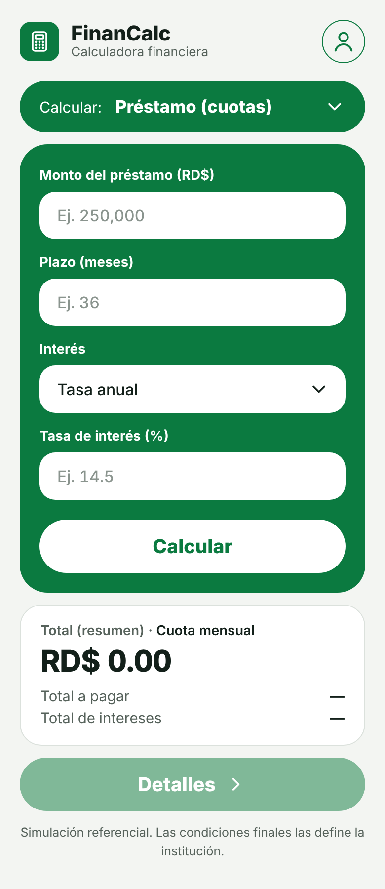
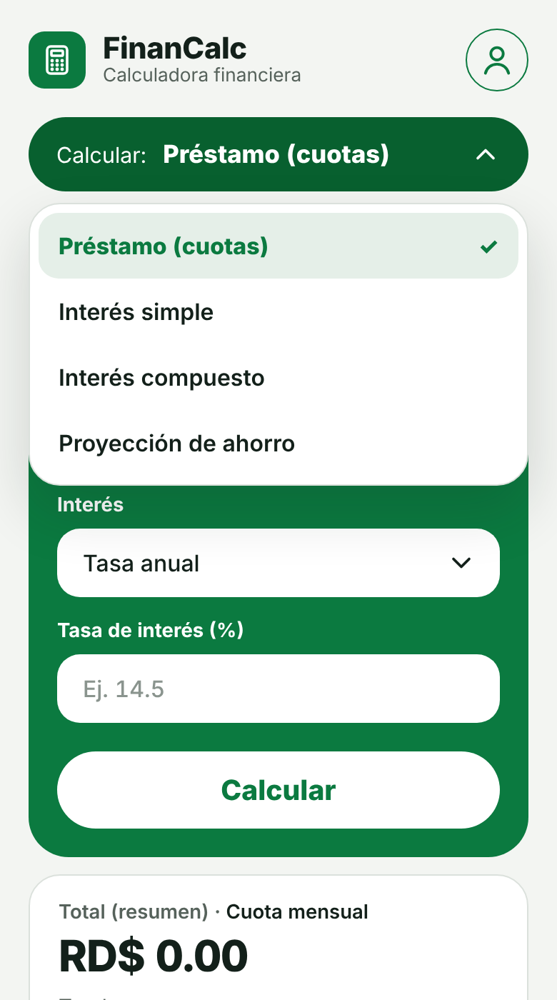
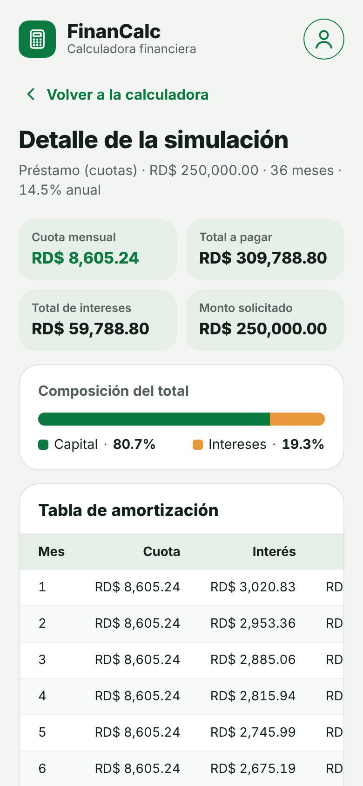
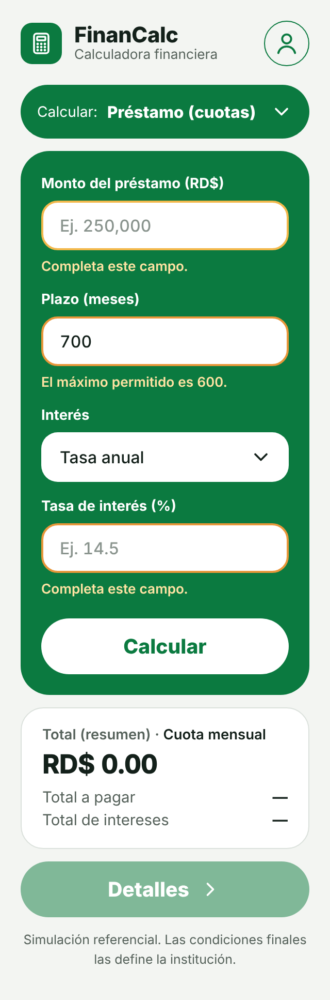
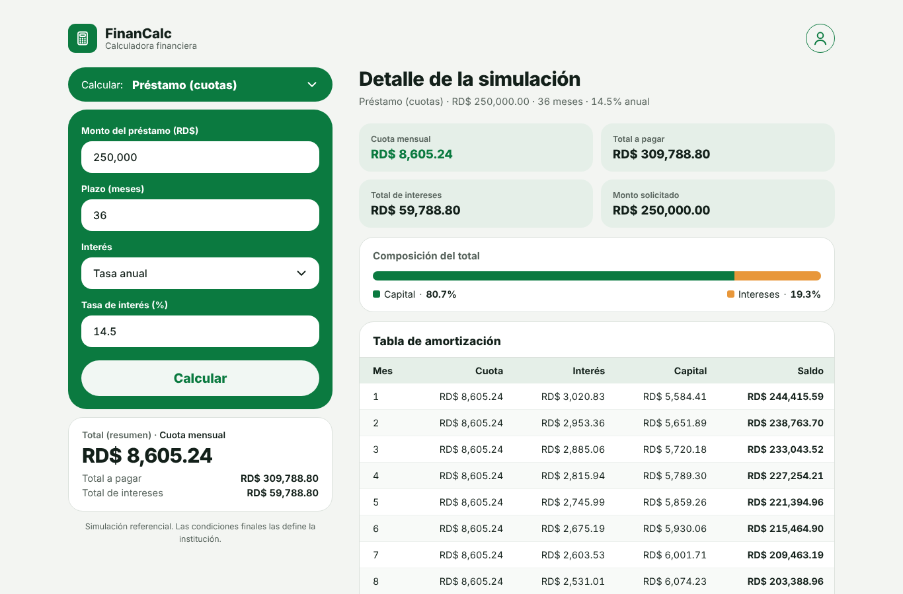

# FinanCalc · Calculadora financiera

Aplicación web hecha con **React + Vite** para simular préstamos, interés simple, interés compuesto y proyecciones de ahorro en pesos dominicanos (RD$). Está diseñada **Mobile First**: primero para celular y después adaptada a tableta y escritorio.

| Celular | Selector de modalidad | Detalle (celular) | Validación |
|---|---|---|---|
|  |  |  |  |

**Escritorio** — formulario a la izquierda y detalle a la derecha:



---

## Funcionalidades

- **4 modalidades** desde el selector «Calcular:», un menú desplegable propio (con el estilo de la app, legible en cualquier sistema operativo y usable con teclado: ↑ ↓, Enter, Esc)
  - **Préstamo (cuotas):** cuota fija mensual (sistema francés) y tabla de amortización.
  - **Interés simple:** con tasa anual o mensual y plazo en meses.
  - **Interés compuesto:** capitalización mensual, trimestral, semestral, anual o diaria.
  - **Proyección de ahorro:** depósito inicial + aportes mensuales.
- **Resumen** inmediato (`Total (resumen)`) y botón **Detalles** con:
  - 4 indicadores clave, barra de **composición del total** (capital vs. intereses) y tabla mes a mes.
- **Validación** por campo con mensajes claros; el foco va al primer campo con error.
- Los montos se formatean mientras escribes (`250000` → `250,000`).
- **Historial** (botón de usuario): guarda las últimas 8 simulaciones en `localStorage` y permite recargarlas.
- El botón «atrás» del celular vuelve del detalle a la calculadora.
- Accesible con teclado y lectores de pantalla (etiquetas, `aria-live`, `aria-invalid`).
- Usable desde **320 px** de ancho, sin desplazamiento horizontal.

## Cómo ejecutarlo

Requisitos: [Node.js](https://nodejs.org/) LTS.

```bash
npm install      # instala dependencias
npm run dev      # abre http://localhost:5173
npm test         # ejecuta las pruebas de las fórmulas
npm run build    # genera la versión de producción en dist/
```

## Estructura

```
src/
├── main.jsx                  # Punto de entrada
├── App.jsx                   # Estado principal y coordinación
├── styles.css                # Estilos Mobile First + media queries
├── components/
│   ├── Header.jsx            # Marca y botón de usuario
│   ├── HistoryMenu.jsx       # Panel «Mis simulaciones» (historial)
│   ├── ModePicker.jsx        # Selector «Calcular:» (menú desplegable accesible)
│   ├── CalculatorForm.jsx    # Formulario generado desde la configuración
│   ├── NumberField.jsx       # Campo numérico reutilizable con formato
│   ├── SelectField.jsx       # Lista desplegable reutilizable
│   ├── SummaryCard.jsx       # Tarjeta «Total (resumen)»
│   ├── DetailsView.jsx       # Pantalla «Detalle de la simulación»
│   ├── StatTiles.jsx         # Indicadores 2×2
│   ├── CompositionBar.jsx    # Barra capital / intereses
│   ├── ScheduleTable.jsx     # Tabla de amortización / evolución
│   └── Icons.jsx             # Íconos SVG
├── hooks/
│   ├── useLocalStorage.js    # useState que persiste en localStorage
│   └── useMediaQuery.js      # Detecta si la pantalla es de escritorio
└── utils/
    ├── finance.js            # Fórmulas (no importa React)
    ├── format.js             # Formato RD$, %, y formato al escribir
    ├── validation.js         # Validación de formularios
    └── calculators.js        # Configuración de cada modalidad
tests/
└── finance.test.js           # Pruebas con node:test
```

**Separación de responsabilidades:** las fórmulas viven en `utils/finance.js` y no saben nada de React; los componentes solo muestran datos; `calculators.js` describe cada modalidad (campos, etiquetas, columnas), por eso agregar una modalidad nueva no requiere copiar JSX.

### Nota de diseño: ¿por qué un menú propio en lugar de `<select>`?
La lista que abre un `<select>` nativo la dibuja el sistema operativo y casi no acepta estilos. En Windows heredaba el texto blanco de la píldora verde y las opciones no se leían. `ModePicker.jsx` usa un `<button>` que abre una lista `role="listbox"`. Su estado `open` es **local**, porque solo le importa a ese componente. La modalidad elegida sigue en `App` y llega por **props** (`value` / `onChange`), así que sigue siendo un componente controlado.

## Fórmulas

| Modalidad | Fórmula |
|---|---|
| Préstamo | Cuota = P · i / (1 − (1 + i)^−n) · si i = 0 → P / n |
| Interés simple | I = C · i · n · Monto = C + I |
| Interés compuesto | M = C · (1 + r/m)^(m·t) |
| Ahorro | Saldo = D·(1+i)^n + A·[((1+i)^n − 1) / i] (aportes a fin de mes) |

`i` = tasa mensual en decimal, `n` = meses, `r` = tasa anual, `m` = capitalizaciones por año, `t` = años.

## Explicación de dos componentes

### `NumberField.jsx` — campo controlado reutilizable
Recibe por **props** `label`, `value`, `onChange`, `placeholder` y `error`. No guarda el valor: el texto vive en el estado de `App` y el campo solo avisa cambios con `onChange` (**input controlado**). Al escribir, `formatTyping()` limpia lo que no sea número y agrega comas de miles; `useRef` permite devolver el cursor a su posición para que no salte al final. Si hay `error`, marca el campo con `aria-invalid` y muestra el mensaje debajo.

### `App.jsx` — coordinador del estado
Contiene los **estados** con `useState`: modalidad activa, valores de cada formulario, errores, resultados y si se ve el detalle. Al enviar el formulario:
1. `event.preventDefault()` evita recargar la página.
2. `validateForm()` convierte los textos a números y busca errores.
3. Si todo está bien, llama a la fórmula de la modalidad (`mode.compute`) y guarda el resultado.
4. React vuelve a renderizar y `SummaryCard`/`DetailsView` muestran las cifras.

Usa `useEffect` para el título de la página, para escuchar el botón «atrás» (`hashchange`) y, mediante el hook `useLocalStorage`, para guardar el historial.

## Pruebas

`npm test` verifica los casos de la guía y los valores del diseño:

| Caso | Entrada | Esperado | ✔ |
|---|---|---|---|
| Préstamo | 250,000 · 36 meses · 14.5% anual | Cuota RD$ 8,605.24 · Total RD$ 309,788.80 | ✔ |
| Préstamo tasa 0 | 1,200 · 12 meses · 0% | Cuota RD$ 100 | ✔ |
| Interés simple | 1,000 · 24 meses · 12% | Interés RD$ 240 · Total RD$ 1,240 | ✔ |
| Interés simple | 50,000 · 18 meses · 9% | Monto final RD$ 56,750.00 | ✔ |
| Compuesto | 100,000 · 5 años · 8% mensual | RD$ 148,984.57 | ✔ |
| Compuesto tasa 0 | 1,000 · 2 años · 0% | RD$ 1,000 | ✔ |
| Ahorro | 10,000 + 3,000/mes · 3 años · 6% | RD$ 129,975.12 | ✔ |
| Validación | Capital −100 / campo vacío / 700 meses | Muestra error | ✔ |
- **¿Por qué `finance.js` no importa React?** Son cálculos puros: se pueden probar con Node y reutilizar en cualquier otra interfaz.

---

_Simulación referencial y educativa. No incluye seguros, impuestos, comisiones ni cambios de tasa._
